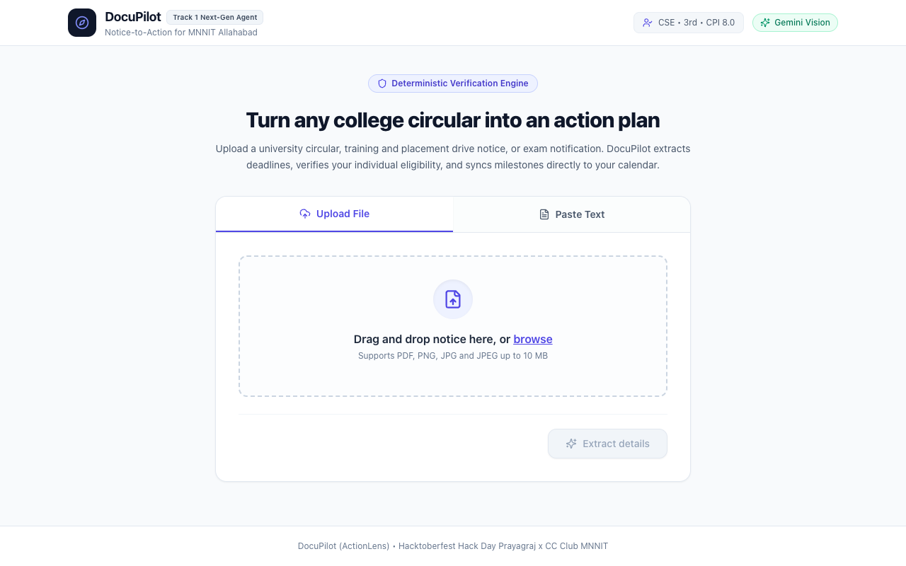
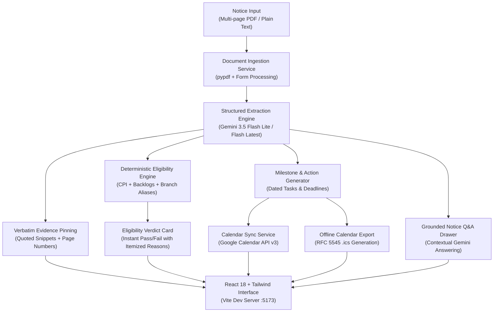

# DocuPilot

**Notice-to-Action Agent for MNNIT Allahabad Students**  
*Submitted for Hacktoberfest Hack Day Prayagraj x CC Club MNNIT*  
*Track 1: Applied AI & Next-Gen Agents*  

---

## Submission Links

- **GitHub Repository**: [https://github.com/Yashwardhan61/DocuPilot.git](https://github.com/Yashwardhan61/DocuPilot.git)
- **Live Local Frontend**: `http://localhost:5173`
- **Interactive API Documentation**: `http://localhost:8000/docs`
- **Video Demo (2 to 3 minutes)**: [Insert Unlisted YouTube or Google Drive Link]

---

## Problem Statement

College students receive dozens of academic circulars, training and placement drive notices, scholarship notifications, and exam schedules every semester. These announcements arrive primarily as complex, multi-page PDFs or raw messaging text where critical parameters—such as tight submission deadlines, strict CPI cutoffs, allowed branches, and mandatory documents—are buried inside formal administrative prose.

Missing a deadline or overlooking an eligibility rule results in missed placement interviews, lost scholarships, or academic penalties.

---

## Solution: What DocuPilot Does

DocuPilot (ActionLens) transforms passive circular reading into proactive execution:

1. **Multimodal Circular Ingestion**: Ingests multi-page PDFs or raw notice text with format validation and automated cleanup.
2. **AI Fact Extraction with Source Evidence**: Uses the Google Gemini REST API to extract key dates, eligibility constraints, required documents, and actionable tasks with verbatim document snippets and page references.
3. **Deterministic Student Eligibility Engine**: Eliminates LLM hallucination for critical compliance decisions by evaluating student CPI, academic year, degree, and MNNIT department aliases against circular rules deterministically.
4. **Google Calendar API & Offline Sync**: Schedules notice deadlines directly into the student's personal Google Calendar with automated popup alarms (24 hours and 3 hours prior), plus an offline RFC 5545 `.ics` export for Apple Calendar, Outlook, and Google Calendar.
5. **Grounded Notice Q&A**: Allows students to ask contextual questions about any circular, answered strictly from document contents.
6. **Student Action Dashboard**: A modern React/Tailwind web interface with an interactive profile switcher, source evidence drawer, and task checklist.

---

## Application Screenshot


*DocuPilot Dashboard: Ingesting an official placement circular, displaying extracted deadlines, live student eligibility evaluation, and grounded notice Q&A.*

---

## System Architecture



---

## Tech Stack & External Library Citations

In accordance with Hacktoberfest Guidebook rules regarding third-party software disclosure, all external frameworks, libraries, and APIs are cited below:

### Artificial Intelligence & Extraction
- **Google Gemini REST API** (`gemini-3.5-flash-lite`, `gemini-flash-latest`): Structured JSON extraction and grounded notice Q&A via direct REST calls.
- **pypdf**: Lightweight, secure PDF parsing and page text extraction without heavy native system dependencies.
- **Pydantic v2**: Type enforcement, input validation, and schema sanitization.

### Backend Infrastructure
- **FastAPI**: Asynchronous Python web framework for microservices and REST endpoints.
- **Uvicorn**: Lightweight ASGI web server.
- **SQLite (Python built-in `sqlite3`)**: Zero-configuration relational database with automated startup schema migrations.
- **HTTPX**: Asynchronous HTTP client for Gemini API and Google Calendar API communication.
- **Native RFC 5545 Engine**: Zero-external-dependency `.ics` calendar generation in pure Python.

### Frontend Interface
- **React 18**: Component-driven reactive user interface.
- **Vite 5**: Fast frontend build tooling and development server with reverse proxy.
- **Tailwind CSS 3**: Responsive utility-first design system.
- **Lucide React**: Clean vector iconography.

---

## Core API Endpoints

| Method | Endpoint | Purpose |
|---|---|---|
| `POST` | `/api/notices` | Ingest PDF circular or raw text; triggers Gemini extraction |
| `GET` | `/api/notices/{id}` | Retrieve stored notice facts, tasks, and evidence metadata |
| `GET` | `/api/notices/{id}/eligibility` | Deterministically evaluate student eligibility with query overrides |
| `POST` | `/api/notices/{id}/ask` | Ask grounded contextual questions about the circular |
| `GET` | `/api/notices/{id}/calendar.ics` | Download standardized offline RFC 5545 iCalendar file |
| `POST` | `/api/notices/{id}/sync-google-calendar` | Push events and popup reminder notifications to Google Calendar |
| `GET` | `/api/profile` | Retrieve stored student profile |
| `POST` | `/api/profile` | Update student profile (branch, year, CPI, active backlogs) |
| `GET` | `/api/auth/google/login` | Initiate Google OAuth 2.0 calendar authorization |
| `GET` | `/api/auth/google/callback` | Exchange OAuth authorization code for Google Calendar access tokens |
| `GET` | `/api/health` | Service health and active configuration status |

---

## Local Setup & Run Guide

### Prerequisites
- Python 3.10, 3.11, or 3.12
- Node.js 18+ and npm
- Google Gemini API Key (from Google AI Studio)

---

### Step 1: Clone the Repository

```bash
git clone https://github.com/Yashwardhan61/DocuPilot.git
cd DocuPilot
```

---

### Step 2: Backend Setup

1. Open a terminal and navigate to the backend directory:
   ```bash
   cd backend
   ```

2. Create and activate a Python virtual environment:
   ```bash
   python3 -m venv venv
   source venv/bin/activate
   ```

3. Install backend dependencies:
   ```bash
   pip install -r requirements.txt
   ```

4. Configure environment variables in `backend/.env`:
   ```env
   GEMINI_API_KEY=your_gemini_api_key_here
   DATABASE_PATH=docupilot.db
   FRONTEND_ORIGIN=http://localhost:5173
   GOOGLE_CLIENT_ID=your_google_client_id.apps.googleusercontent.com
   GOOGLE_CLIENT_SECRET=your_google_client_secret
   GOOGLE_REDIRECT_URI=http://localhost:8000/api/auth/google/callback
   ```

5. Start the backend server:
   ```bash
   uvicorn app.main:app --host 127.0.0.1 --port 8000 --reload
   ```
   *Backend interactive Swagger documentation will be available at `http://127.0.0.1:8000/docs`.*

---

### Step 3: Frontend Setup

1. Open a second terminal and navigate to the frontend directory:
   ```bash
   cd frontend
   ```

2. Install npm dependencies:
   ```bash
   npm install
   ```

3. Start the Vite development server:
   ```bash
   npm run dev
   ```
   *Web application will be accessible at `http://localhost:5173`.*

---

## Team Members & Division of Work

| Member Name | Role | Email | GitHub | Key Responsibilities |
|---|---|---|---|---|
| **Yashwardhan Singh** | Team Lead & Backend Architecture | yashrock.ys61@gmail.com | [@Yashwardhan61](https://github.com/Yashwardhan61) | System architecture, SQLite database persistence layer & auto-migrations, Google Calendar API v3 integration, native RFC 5545 `.ics` calendar generation, FastAPI routers, repository branch workflows. |
| **Aditi Gupta** | AI Intelligence & Eligibility Logic | aditigupta.21apr@gmail.com | [@AditiGupta21](https://github.com/AditiGupta21) | Pydantic schema architecture, dual PDF/text extraction pipeline (`pypdf`), deterministic student eligibility engine with MNNIT department alias normalization, Gemini REST API client with model fallback & grounded Q&A. |
| **Grishma Doshi** | Frontend & User Experience | grishmadoshi2@gmail.com | [@grishmadoshi](https://github.com/grishmadoshi) | React 18 + Tailwind CSS user interface, NoticeUpload component (drag-and-drop & paste mode), 4-stage animated loading skeleton, interactive Student Profile switcher, source evidence drawer, and end-to-end API integration. |

---

## License

This project is licensed under the [MIT License](LICENSE) &copy; 2026 Yashwardhan Singh, Grishma Doshi, Aditi Gupta.
