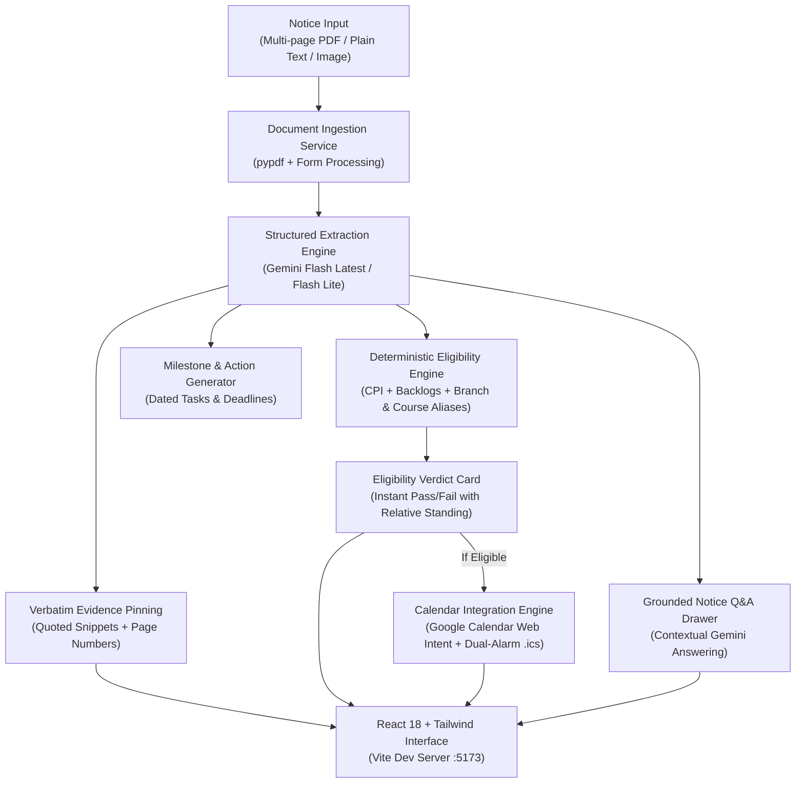

# DocuPilot

**Notice-to-Action Agent for MNNIT Allahabad Students**  
*Submitted for Hacktoberfest Hack Day Prayagraj x CC Club MNNIT*  
*Track 1: Applied AI & Next-Gen Agents*  

---

## Submission Links

- **GitHub Repository**: [https://github.com/Yashwardhan61/DocuPilot.git](https://github.com/Yashwardhan61/DocuPilot.git)
- **Live Local Frontend**: `http://localhost:5173`
- **Interactive API Documentation**: `http://localhost:8000/docs`
- **Video Demo**: [Watch Full Demo Video on Google Drive](https://drive.google.com/file/d/1_SDS5hW5lJMOVNS8O5hRELwfgoPM5DOa/view?usp=drivesdk)

---

## Video Demonstration

Watch the complete 2 to 3 minute demonstration of DocuPilot in action:
- **Google Drive Video Player**: [Click to Watch Full Walkthrough Video](https://drive.google.com/file/d/1_SDS5hW5lJMOVNS8O5hRELwfgoPM5DOa/view?usp=drivesdk)

---

## Problem Statement

College students receive dozens of academic circulars, training and placement drive notices, scholarship notifications, and exam schedules every semester. These announcements arrive primarily as complex, multi-page PDFs or raw messaging text where critical parameters—such as tight submission deadlines, strict CPI cutoffs, allowed branches, and mandatory documents—are buried inside formal administrative prose.

Missing a deadline or overlooking an eligibility rule results in missed placement interviews, lost scholarships, or academic penalties.

---

## Solution: What DocuPilot Does

DocuPilot transforms passive circular reading into proactive execution:

1. **Multimodal Circular Ingestion**: Ingests multi-page PDFs, images, or raw notice text with format validation and automated cleanup.
2. **AI Fact Extraction with Source Evidence**: Uses the Google Gemini REST API to extract key dates, eligibility constraints, target courses, target branches, required documents, and actionable tasks with verbatim document snippets and page references.
3. **Genuine Firebase Authentication**: Secure student authentication powered by Firebase Authentication with Google Sign-In, automatically pulling student name, email, and Google avatar.
4. **Academic Course vs. Department Distinction**: Separates Degree Programs (B.Tech, M.Tech, MCA, MBA, M.Sc, Ph.D.) from Academic Departments (CSE, IT, ECE, EE, ME, CE, CH, BT).
5. **Dynamic Course Duration & Academic Standing Engine**:
   - **B.Tech** (4 Years): Year 3 is Pre-Final Year; Year 4 is Final Year.
   - **M.Tech / MBA / M.Sc** (2 Years): Year 1 is Pre-Final Year; Year 2 is Final Year.
   - **MCA** (3 Years at MNNIT): Year 1 is First Year; Year 2 is Pre-Final Year; Year 3 is Final Year.
   - **Ph.D. / Dual Degree** (5 Years): Year 4 is Pre-Final Year; Year 5 is Final Year.
   - **AI Degree Analysis**: Endpoints analyze any custom or non-standard degree via Gemini and university curriculum rules.
6. **Course-Aware Deterministic Eligibility Engine**: Evaluates student CPI, active backlogs, department aliases, and relative academic standing against circular requirements without hallucination.
7. **Missed Deadline Detection**: Automatically flags dates in the past with visual strike-through and prominent indicators, preventing students from setting reminders for expired deadlines.
8. **Simultaneous Google Calendar Intent & 1-Click .ics Sync**:
   - **Direct Google Calendar Web Intent**: Opens in a new tab with pre-filled title, dates, verbatim notice snippet, and milestone notes without requiring sensitive OAuth scopes or triggering unverified app warning screens.
   - **RFC 5545 Dual-Alarm .ics Download**: Simultaneously downloads a single-event calendar file configured with both 12-hour (`-PT12H`) and 3-hour (`-PT3H`) prior reminder alarms, compatible with Google Calendar, Apple Calendar, and Outlook.
9. **Grounded Notice Q&A**: Allows students to ask contextual questions about any circular, answered strictly from document contents.
10. **Student Action Dashboard**: A clean, light-themed React/Tailwind web interface with an adaptive profile switcher, dynamic year clamping, and task checklist.

---

## System Architecture



---

## Tech Stack & External Library Citations

In accordance with Hacktoberfest Guidebook rules regarding third-party software disclosure, all external frameworks, libraries, and APIs are cited below:

### Artificial Intelligence & Extraction
- **Google Gemini REST API** (`gemini-flash-latest`, `gemini-flash-lite-latest`): Structured JSON extraction and grounded notice Q&A via direct REST calls.
- **pypdf**: Lightweight, secure PDF parsing and page text extraction without native system dependencies.
- **Pydantic v2**: Strict type enforcement, schema sanitization, and input validation.

### Backend Infrastructure
- **FastAPI**: Asynchronous Python web framework for microservices and REST endpoints.
- **Uvicorn**: High-performance ASGI web server.
- **SQLite (Python built-in `sqlite3`)**: Relational database with automatic schema migrations for student profiles, notices, and task states.
- **HTTPX**: Asynchronous HTTP client for Gemini API communication.

### Authentication & Cloud Services
- **Firebase Authentication**: Genuine Google Sign-In with client credential resolution and live session persistence.

### Frontend Interface
- **React 18**: Component-driven reactive user interface.
- **Vite 5**: Fast frontend build tooling and development server with reverse proxy.
- **Tailwind CSS 3**: Responsive light-theme design system.
- **Lucide React**: Clean vector iconography.

---

## Core API Endpoints

| Method | Endpoint | Purpose |
|---|---|---|
| `POST` | `/api/notices` | Ingest PDF circular, image, or raw text; triggers Gemini extraction |
| `GET` | `/api/notices/{id}` | Retrieve stored notice facts, tasks, and evidence metadata |
| `GET` | `/api/notices` | List all processed notices and circulars |
| `GET` | `/api/notices/{id}/eligibility` | Deterministically evaluate student eligibility with course-aware year logic |
| `POST` | `/api/notices/{id}/ask` | Ask grounded contextual questions about the circular |
| `GET` | `/api/notices/{id}/calendar.ics` | Download RFC 5545 calendar file with dual 12h & 3h prior alarms |
| `POST` | `/api/notices/{id}/sync-google-calendar` | Directly schedule 12h & 3h prior reminder notifications in Google Calendar |
| `GET` | `/api/course/duration` | Lookup program duration, pre-final year, and final year |
| `POST` | `/api/course/analyze` | AI-assisted course duration and milestone evaluation for custom degrees |
| `GET` | `/api/profile` | Retrieve saved student profile |
| `POST` | `/api/profile` | Update student profile (course, department, branch, year, CPI, backlogs) |
| `GET` | `/api/health` | Service health and active configuration status |

---

## Local Setup & Run Guide

### Prerequisites
- Python 3.10, 3.11, 3.12, or 3.14
- Node.js 18+ and npm
- Google Gemini API Key (from Google AI Studio)
- Firebase Project credentials (configured for Google Auth)

---

### Step 1: Clone the Repository

```bash
git clone https://github.com/Yashwardhan61/DocuPilot.git
cd DocuPilot
```

---

### Step 2: Backend Setup

1. Open a terminal and navigate to the backend directory:
   ```bash
   cd backend
   ```

2. Create and activate a Python virtual environment:
   ```bash
   python3 -m venv venv
   source venv/bin/activate
   ```

3. Install backend dependencies:
   ```bash
   pip install -r requirements.txt
   ```

4. Configure environment variables in `backend/.env`:
   ```env
   GEMINI_API_KEY=your_gemini_api_key_here
   DATABASE_PATH=docupilot.db
   FRONTEND_ORIGIN=http://localhost:5173
   GOOGLE_CLIENT_ID=your_google_client_id.apps.googleusercontent.com
   GOOGLE_CLIENT_SECRET=your_google_client_secret
   ```

5. Start the backend server:
   ```bash
   uvicorn app.main:app --host 127.0.0.1 --port 8000 --reload
   ```
   *Backend interactive Swagger documentation is available at `http://127.0.0.1:8000/docs`.*

---

### Step 3: Frontend Setup

1. Open a second terminal and navigate to the frontend directory:
   ```bash
   cd frontend
   ```

2. Install npm dependencies:
   ```bash
   npm install
   ```

3. Configure Firebase credentials in `frontend/.env`:
   ```env
   VITE_FIREBASE_API_KEY=your_firebase_api_key
   VITE_FIREBASE_AUTH_DOMAIN=your_project.firebaseapp.com
   VITE_FIREBASE_PROJECT_ID=your_project_id
   VITE_FIREBASE_STORAGE_BUCKET=your_project.appspot.com
   VITE_FIREBASE_MESSAGING_SENDER_ID=your_sender_id
   VITE_FIREBASE_APP_ID=your_app_id
   ```

4. Start the Vite development server:
   ```bash
   npm run dev
   ```
   *Web application will be accessible at `http://localhost:5173`.*

---

## Team Members & Division of Work

| Member Name | Role | Email | GitHub | Key Responsibilities |
|---|---|---|---|---|
| **Yashwardhan Singh** | Team Lead & Backend Architecture | yashrock.ys61@gmail.com | [@Yashwardhan61](https://github.com/Yashwardhan61) | System architecture, SQLite database persistence layer & auto-migrations, dynamic course duration service, dual-alarm calendar intent & RFC 5545 .ics generation, FastAPI routers, repository workflows. |
| **Aditi Gupta** | AI Intelligence & Eligibility Logic | aditigupta.21apr@gmail.com | [@AditiGupta21](https://github.com/AditiGupta21) | Pydantic schema architecture, dual PDF/text extraction pipeline (`pypdf`), deterministic student eligibility engine with course-aware relative standing resolution, Gemini REST API client with model fallback & grounded Q&A. |
| **Grishma Doshi** | Frontend & User Experience | grishmadoshi2@gmail.com | [@grishmadoshi](https://github.com/grishmadoshi) | React 18 + Tailwind CSS light theme user interface, NoticeUpload component, Firebase Authentication with Google Sign-In, dynamic academic Profile Setup modal with automatic year clamping, missed deadline badge, and student dashboard integration. |

---

## License

This project is licensed under the [MIT License](LICENSE) &copy; 2026 Yashwardhan Singh, Grishma Doshi, Aditi Gupta.
