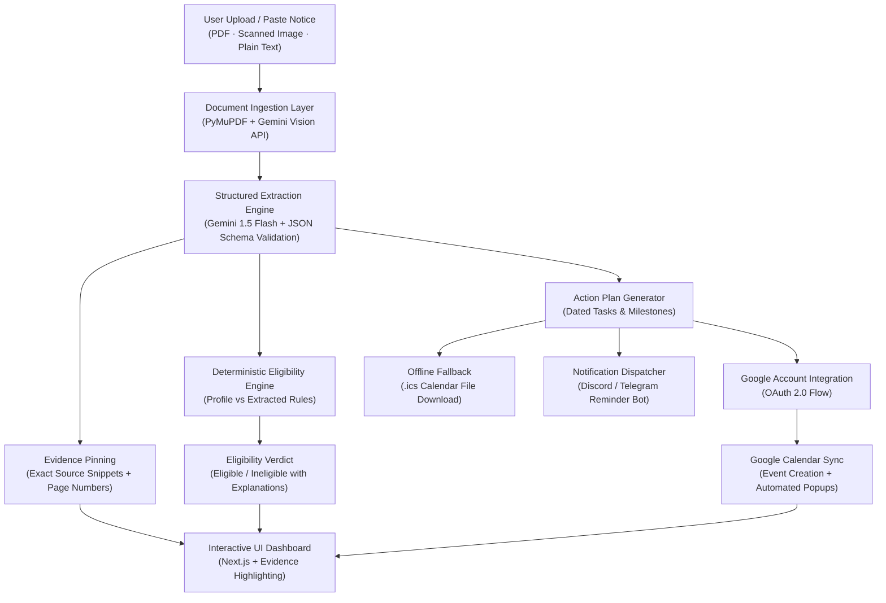

# DocuPilot 

Notice-to-Action Agent for Students

Project for Hacktoberfest Hack Day Prayagraj x CC Club MNNIT | Track 1: Applied AI & Next-Gen Agents
**Notice-to-Action Agent for MNNIT Students**

*Submitted for Hacktoberfest Hack Day Prayagraj x CC Club MNNIT*
*Track 1: Applied AI & Next-Gen Agents*

---

## Submission Links

- **Video Demo (2 to 3 minutes)**: [PLACEHOLDER: Insert Unlisted YouTube or Google Drive Link Here]
- **Live Deployment URL**: [PLACEHOLDER: Insert Vercel / Render Production URL Here]
- **GitHub Repository**: [PLACEHOLDER: Insert Public GitHub Repository Link Here]

---

## Problem Statement

Students receive circulars, notices, and PDFs loaded with deadlines, eligibility criteria, and mandatory documents. Crucial details often get buried in long text, leading to missed opportunities.

## What ActionLens Does

1. **Notice Ingestion**: Upload PDF, image, or raw text notices.
2. **AI Extraction with Evidence**: Extracts deadlines, eligibility criteria, required documents, and action items with exact source snippets and page references.
3. **Personal Eligibility Check**: Checks student branch, year, and CGPA deterministically against extracted rules.
4. **Google Account & Calendar Sync**: Direct integration with the user's personal Google Account to sync extracted deadlines and action items straight into Google Calendar with automated reminder notifications.
5. **Interactive Dashboard**: Highlight source evidence upon clicking any deadline or requirement.
   Students receive an overwhelming volume of academic notices, placement circulars, scholarship announcements, and exam schedules through PDFs, scanned images, and messaging groups. Critical information—such as strict deadlines, CGPA cutoffs, branch limitations, and mandatory documents—is buried within dense bureaucratic text. Missing a single requirement or deadline can lead to lost placement drives, scholarship disqualifications, or academic penalties.

## Architecture & Tech Stack

- **Frontend**: Next.js, Tailwind CSS
- **Backend**: FastAPI (Python), SQLite
- **AI Processing**: Google Gemini Flash (structured JSON output)
- **Document Parsing**: Gemini Vision API with PyMuPDF fallback
- **Calendar & Reminders**: Google Calendar API (OAuth 2.0), fallback ICS export, Discord bot

---

## Core Endpoints

- `POST /api/notices`: Upload and extract notice facts
- `GET /api/notices/{id}`: Retrieve extraction and task checklist
- `POST /api/profile`: Save student profile (branch, year, CGPA)
- `GET /api/notices/{id}/eligibility`: Evaluate personal eligibility
- `GET /api/auth/google/login`: Google OAuth consent redirection
- `GET /api/auth/google/callback`: OAuth token exchange and storage
- `POST /api/notices/{id}/sync-google-calendar`: Directly create calendar events with notifications
- `GET /api/notices/{id}/calendar.ics`: Fallback offline calendar download

## Solution Overview

DocuPilot (ActionLens) is an autonomous notice-to-action agent that bridges the gap between passive reading and proactive execution. Instead of acting as a simple conversational chatbot, DocuPilot executes an end-to-end agentic workflow:

1. **Multimodal Notice Ingestion**: Ingests multi-page PDFs, scanned notice images, or raw text.
2. **Schema-Validated Fact Extraction**: Uses Google Gemini to extract deadlines, eligibility conditions, required documents, and action items with exact source snippets and page references.
3. **Personal Eligibility Verification**: Deterministically checks whether the student meets branch, graduation year, and CGPA requirements, eliminating AI hallucinations for compliance checks.
4. **Direct Google Calendar Integration**: Authenticates via Google OAuth 2.0 and directly schedules deadlines and reminder popups into the student's personal Google Calendar.
5. **Interactive Evidence Dashboard**: Allows students to click any extracted requirement or deadline to inspect the highlighted source snippet from the original document.
6. **Multi-Channel Reminders**: Generates offline `.ics` calendar files and schedules automated deadline alerts via Discord/Telegram bots.

---

## Visual Walkthrough & Screenshots

<!-- Replace these placeholders with actual screenshots or animated GIFs of the working prototype -->

### 1. Notice Upload & Analysis


*[PLACEHOLDER: Screenshot showing file upload of an official notice with status indicators]*

### 2. Extracted Facts with Evidence Highlighting


*[PLACEHOLDER: Screenshot displaying extracted deadlines, documents, and the side drawer highlighting source text]*

### 3. Eligibility Verdict


*[PLACEHOLDER: Screenshot displaying Eligible or Ineligible status with specific criteria breakdown]*

### 4. Google Calendar Live Sync


*[PLACEHOLDER: Screenshot displaying events created in Google Calendar with reminder notifications]*

---

## System Architecture



---

## Tech Stack & Third-Party Library Citations

In accordance with Hacktoberfest Guidebook rules regarding third-party software disclosure, all external frameworks, libraries, and APIs are cited below:

### Artificial Intelligence & Parsing

- **Google Gemini 1.5 Flash API**: Multimodal document comprehension and schema-constrained JSON extraction.
- **PyMuPDF (`fitz`)**: Local PDF text extraction, page splitting, and fallback document parsing.
- **Pydantic / jsonschema**: Strict validation and sanitization of LLM JSON outputs.

### Backend Services

- **FastAPI (Python)**: High-performance asynchronous REST API framework.
- **Uvicorn**: Asynchronous Server Gateway Interface (ASGI) web server.
- **SQLite**: Zero-configuration relational database for notices, student profiles, and task states (built into standard Python).
- **HTTPX**: Lightweight asynchronous HTTP client for direct Google Gemini REST API and Google Calendar API v3 communication.
- **Native RFC 5545 Engine**: Zero-dependency iCalendar (.ics) generation using standard Python.
- **pypdf**: Lightweight document parsing for multi-page notices.

### Frontend Interface

- **Next.js (React)**: Component architecture and client-side routing.
- **Tailwind CSS**: Utility-first styling framework.
- **Lucide Icons**: Semantic interface icons.

### Development & AI Tooling

- **Antigravity AI Agent**: Architecture specification, schema design, and pair-programming assistant.

---

## Local Setup & Installation

Follow these instructions to run the entire stack locally.

### Prerequisites

- Node.js (v18.0.0 or higher) and npm
- Python (v3.10, v3.11, or v3.12)
- Google Cloud Console project with **Google Calendar API** enabled and OAuth 2.0 credentials configured
- Google Gemini API key (via Google AI Studio)

---

### Step 1: Clone the Repository

```bash
git clone https://github.com/yashwardhan61/DocuPilot.git
cd DocuPilot
```

---

### Step 2: Configure Environment Variables

Create `.env` files in both backend and frontend directories as outlined below.

#### Backend Environment Configuration (`backend/.env`):

```env
# Gemini API Key from Google AI Studio
GEMINI_API_KEY=[PLACEHOLDER: your_gemini_api_key_here]

# Google OAuth 2.0 Credentials (Google Cloud Console)
GOOGLE_CLIENT_ID=[PLACEHOLDER: your_google_client_id_here.apps.googleusercontent.com]
GOOGLE_CLIENT_SECRET=[PLACEHOLDER: your_google_client_secret_here]
GOOGLE_REDIRECT_URI=http://localhost:8000/api/auth/google/callback

# Discord Bot Token (Optional for reminder bot)
DISCORD_BOT_TOKEN=[PLACEHOLDER: your_discord_bot_token_here]
DISCORD_CHANNEL_ID=[PLACEHOLDER: your_target_discord_channel_id_here]

# Application Settings
DATABASE_URL=sqlite:///./docupilot.db
FRONTEND_ORIGIN=http://localhost:3000
```

#### Frontend Environment Configuration (`frontend/.env.local`):

```env
NEXT_PUBLIC_BACKEND_API_URL=http://localhost:8000
```

---

### Step 3: Backend Setup (FastAPI)

1. Navigate to the backend directory:

   ```bash
   cd backend
   ```
2. Create and activate a Python virtual environment:

   ```bash
   python3 -m venv venv
   source venv/bin/activate
   ```
3. Install required Python packages:

   ```bash
   pip install -r requirements.txt
   ```
4. Start the FastAPI development server:

   ```bash
   uvicorn main:app --reload --host 0.0.0.0 --port 8000
   ```

   *The backend will be accessible at `http://localhost:8000` with interactive Swagger docs at `http://localhost:8000/docs`.*

---

### Step 4: Frontend Setup (Next.js)

1. Open a new terminal and navigate to the frontend directory:

   ```bash
   cd frontend
   ```
2. Install dependencies:

   ```bash
   npm install
   ```
3. Launch the Next.js development server:

   ```bash
   npm run dev
   ```

   *The web application will be accessible at `http://localhost:3000`.*

---

## API Reference

| Method   | Endpoint                                   | Purpose                                                             |
| -------- | ------------------------------------------ | ------------------------------------------------------------------- |
| `POST` | `/api/notices`                           | Upload file (PDF/Image) or paste text; triggers Gemini extraction   |
| `GET`  | `/api/notices/{id}`                      | Retrieve extracted facts, tasks, and evidence metadata              |
| `POST` | `/api/profile`                           | Save student profile (`branch`, `year`, `cgpa`)               |
| `GET`  | `/api/notices/{id}/eligibility`          | Compute personal eligibility verdict against extracted notice rules |
| `GET`  | `/api/auth/google/login`                 | Redirect to Google OAuth consent screen                             |
| `GET`  | `/api/auth/google/callback`              | Process OAuth code exchange and store user credentials              |
| `GET`  | `/api/auth/status`                       | Verify Google Account connection status                             |
| `POST` | `/api/notices/{id}/sync-google-calendar` | Create events and popup reminders in primary Google Calendar        |
| `GET`  | `/api/notices/{id}/calendar.ics`         | Download standardized offline iCalendar file                        |
| `POST` | `/api/notices/{id}/remind`               | Schedule automated notification via Discord bot                     |

---

## Collaborative Git Workflow

This project adheres to the Hacktoberfest open-source engineering standards:

- **Feature Branching**: Development is divided across modular feature branches (`feature/notice-upload`, `feature/gemini-parser`, `feature/eligibility-logic`, `feature/google-calendar-sync`, `feature/frontend-dashboard`).
- **Pull Requests & Code Reviews**: Features are merged into `main` strictly through documented Pull Requests reviewed by teammates.
- **Commit History**: Clean, descriptive commit logs reflecting continuous, distributed contributions from all team members.

---

## Team Members & Contributions

| Member Name                         | College Email / Roll No          | GitHub Profile                  | Primary Responsibilities                                                                |
| ----------------------------------- | -------------------------------- | ------------------------------- | --------------------------------------------------------------------------------------- |
| [PLACEHOLDER: Member 1 Name (Lead)] | [PLACEHOLDER: email@mnnit.ac.in] | [PLACEHOLDER: @github_username] | UI/UX Design, Next.js Dashboard, Evidence Highlighting Interface, Client Integration    |
| [PLACEHOLDER: Member 2 Name]        | [PLACEHOLDER: email@mnnit.ac.in] | [PLACEHOLDER: @github_username] | FastAPI Backend, SQLite Data Models, Eligibility Engine, Google OAuth & Calendar Sync   |
| [PLACEHOLDER: Member 3 Name]        | [PLACEHOLDER: email@mnnit.ac.in] | [PLACEHOLDER: @github_username] | Gemini Prompt Engineering, Schema Validation, Document Extraction, Discord Reminder Bot |

---

## License

This project is licensed under the [MIT License](LICENSE).
